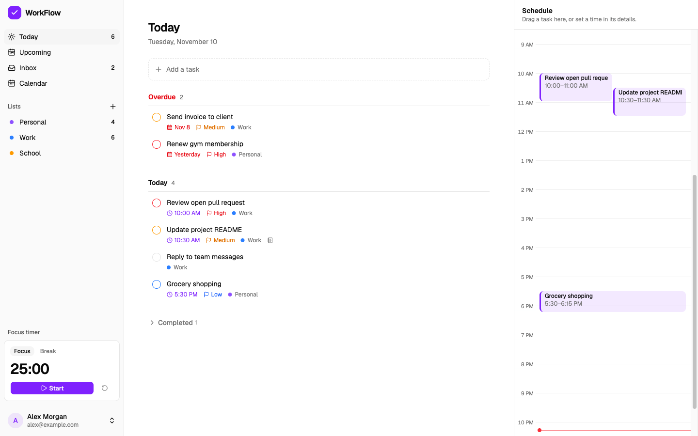
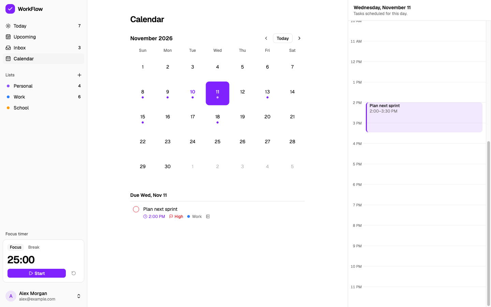
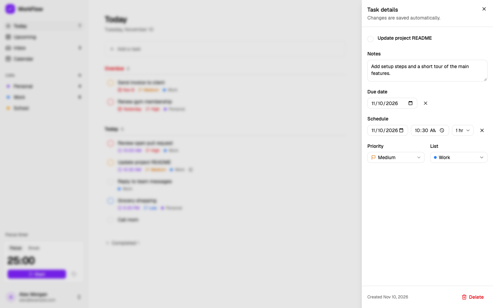
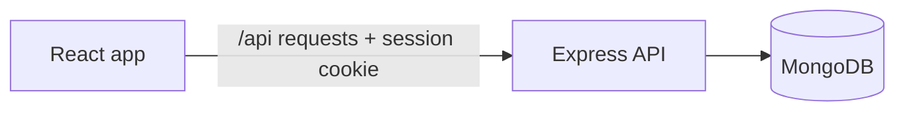

# WorkFlow

**Plan your day, then focus on it.** WorkFlow is a minimal daily planner that brings your tasks, a day timeline, a month calendar and a focus timer into one calm view.



**Live app:** _link coming soon_

## Features

- **Tasks and lists.** Add a task in a keystroke, then give it a list, due date, priority and notes. Tasks without a list wait in the Inbox.
- **Today.** Overdue and due-today tasks in one list, with the day's schedule beside it.
- **Drag to schedule.** Drag a task onto the timeline to block out time for it. Overlapping blocks sit side by side.
- **Upcoming and Calendar.** Future tasks grouped by day, and a month view with each day's tasks and schedule.
- **Focus timer.** 25 minutes of focus, then a 5-minute break. It stays accurate in background tabs and survives a page reload.
- **Accounts.** Sign up with email and password; each user only ever sees their own data.

| Calendar                                                              | Task details                                                                                   |
| --------------------------------------------------------------------- | ---------------------------------------------------------------------------------------------- |
|  |  |

## Tech stack

|                         |                                                                                                                        |
| ----------------------- | ---------------------------------------------------------------------------------------------------------------------- |
| **Client**              | React 19, Vite, React Router, TanStack Query, Tailwind CSS, shadcn/ui, dnd-kit, date-fns, react-hook-form, zod         |
| **Server**              | Node.js, Express 5, MongoDB with Mongoose, express-session with connect-mongo, bcrypt, zod, helmet, express-rate-limit |
| **Testing and tooling** | Vitest, Supertest, mongodb-memory-server, React Testing Library, ESLint, Prettier, GitHub Actions                      |

## How it works

One repository with two npm workspaces: an Express JSON API in `server/` and a React single-page app in `client/`.



- **One origin.** In development, Vite forwards `/api` requests to Express. In production, Express also serves the built React app. The browser sees a single site, so the session cookie just works and there's no CORS setup.
- **Session-based auth.** Passwords are hashed with bcrypt. Logging in stores the user's id in a server-side session (kept in MongoDB) and sets an httpOnly, SameSite=Lax cookie. The session id is regenerated on login, and login and signup are rate limited.
- **Every query is scoped to the signed-in user.** Another user's task returns 404, as if it doesn't exist. Tests check this.
- **Validation on both sides.** zod checks every request body and query on the server (unknown fields are stripped), and the same rules give instant feedback in the forms. One error handler returns every error in the same shape: `{ error, fields? }`.
- **Server data lives in TanStack Query.** Each view asks for tasks with a filter. After any change, the client refetches every task view, so the Today list, the schedule, the calendar and the sidebar counts always agree with the server.
- **Dates are handled carefully.** A due date is a calendar day (`"2026-11-13"`), so "due Friday" means Friday in any timezone. Scheduled times are exact moments stored in UTC.

## Project structure

```
server/
  src/
    app.js           middleware and routes
    config/          environment variables, checked at startup
    routes/          URLs, auth guard, rate limiting
    controllers/     request handling: validate, query, respond
    models/          User, List and Task schemas
    middleware/      requireAuth, errorHandler
  tests/             API tests
client/
  src/
    app/             providers and routes
    features/        auth, tasks, lists, agenda, calendar, focus
    components/      app layout and UI components
    lib/             API client, query setup, date helpers
```

## Running it locally

You'll need **Node.js 22 or newer** and a **MongoDB** connection string (a free [MongoDB Atlas](https://www.mongodb.com/) cluster or a local MongoDB).

```bash
git clone https://github.com/Nafisa-Huda/WorkFlow.git
cd WorkFlow
npm install

cp server/.env.example server/.env
# Edit server/.env: set MONGODB_URI, and SESSION_SECRET

npm run dev
```

The app runs at http://localhost:5173 and the API at http://localhost:4000.

## Scripts

Run from the repository root:

| Command          | What it does                                                 |
| ---------------- | ------------------------------------------------------------ |
| `npm run dev`    | Starts the API and the client together, with reloading       |
| `npm test`       | Runs the API and client test suites                          |
| `npm run lint`   | Lints both workspaces                                        |
| `npm run format` | Formats everything with Prettier                             |
| `npm run build`  | Builds the client into `client/dist`                         |
| `npm start`      | Starts the API (and, in production, serves the built client) |

## Testing

- **API:** integration tests send real HTTP requests to the app with Supertest, against an in-memory MongoDB that's wiped between tests. They cover signup and login, the task lifecycle, filters, validation, and that users can't see or change each other's data.
- **Client:** React Testing Library renders the real app with a mocked API and checks the Today view, plus unit tests for the schedule layout, date helpers and the focus timer.
- **CI:** GitHub Actions checks formatting, lints, runs both test suites and builds the client on every push and pull request.

## Next Steps

- Password reset by email
- Dark mode
